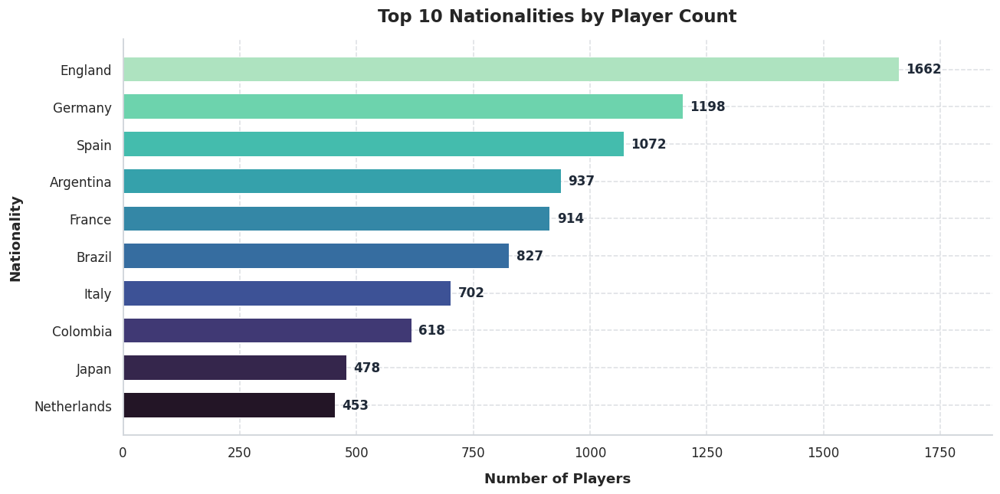
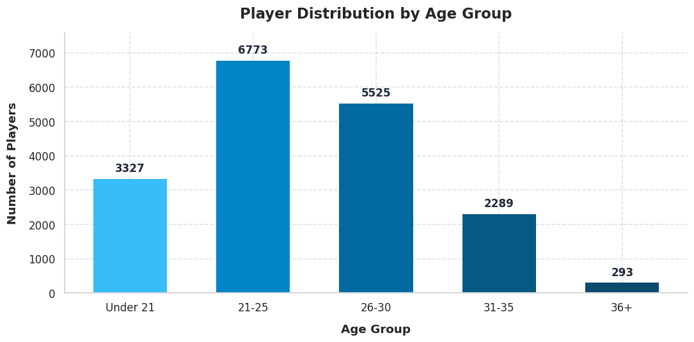
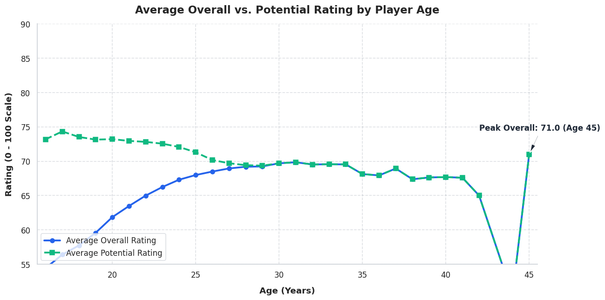
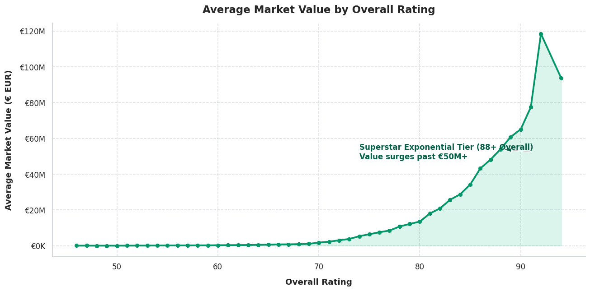
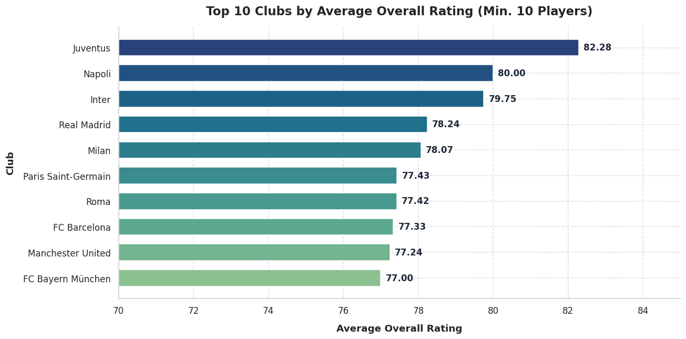
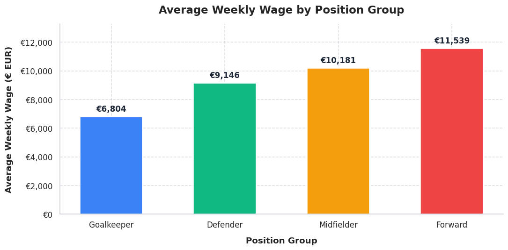
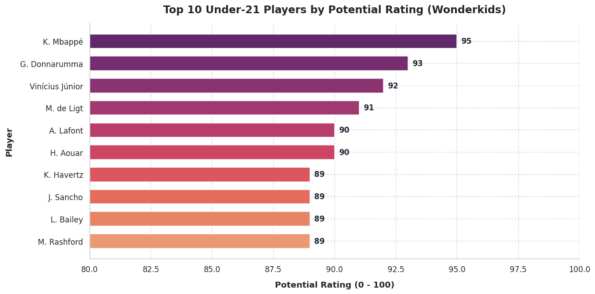

# fifa-19-player-data
Statistical and exploratory analysis of player attributes, valuations, and career potential using FIFA 19 data (Python)

## FIFA 19 Player Analysis & Scouting Dashboard
A Python data analysis project that studies player attributes, career trajectories, financial dynamics, and prospective talent scouting across 18,207 professional footballers, using Pandas, NumPy, Matplotlib, and Seaborn.

## Team
| Name | Enrollment No. |
| :--- | :--- |
| Vora Maurya Prakashkumar | IU2441230547 |
| Saradava Rushil Shantilal | IU2441230513 |

**Course:** Python Programming  
**Guide:** Prof. Vatsal Shinghala  
**GitHub Repository:** [https://github.com/mouryaVora03/fifa-19-player-data](https://github.com/mouryaVora03/fifa-19-player-data)

---

## Project Definition
We want to understand what factors determine player ratings, market valuations, and wage distributions in professional football. The project cleans the raw FIFA 19 dataset, converts complex currency strings and imperial physical measurements, compares player age groups, analyzes career rating trajectories across ages, measures market value growth with ability, and identifies top under-21 wonderkids for scouting.

---

## Dataset
FIFA 19 Complete Player Dataset, Kaggle: [https://www.kaggle.com/datasets/karangadiya/fifa19](https://www.kaggle.com/datasets/karangadiya/fifa19)
* 18,207 rows and 89 columns
* Over 650 clubs and 160+ nationalities
* Covers physical metrics, skill attributes, tactical positions, market values, and wages
* Missing values were found across financial and contract columns. They were converted, parsed, and imputed using median and mode strategies.

---

## Results and Graphs

### Main findings
* Over 66% of all professional players are in their athletic prime between ages 21 and 30, with active player counts declining sharply after age 32.
* The rating gap between Potential and Overall is widest for teenagers (18–22 points) and converges around age 27–29. Peak average performance plateaus between ages 28 and 31.
* Market valuation follows an exponential power law rather than a linear curve: players rated 88+ command massive market premiums exceeding €50M to €100M+.
* Forwards (average ~€10.5K/week) and Midfielders (~€9.9K/week) earn significantly higher wages than Defenders and Goalkeepers.
* Kylian Mbappé leads all Under-21 prospects worldwide with a 95 Potential rating at age 19.

---

### Top 10 nationalities

England (1,662), Germany (1,198), and Spain (1,072) have the highest player counts, heavily driven by multi-tier domestic league systems.

### Player distribution by age group

The 21–25 cohort forms the largest segment of active professionals (6,419 players), followed closely by 26–30 (5,630 players).

### Average overall and potential ratings by age

Potential drops steadily after teenage years, while average Overall rises until peaking around ages 28–31.

### Market value by overall rating

Valuation surges exponentially past 85+ Overall, illustrating the extreme superstar economic premium.

### Top 10 clubs by average overall rating

Juventus, Napoli, Barcelona, Real Madrid, and Bayern Munich lead global football with average squad ratings between 77 and 82.

### Average wage by position group

Forwards and midfielders capture higher compensation than defenders and goalkeepers due to the market premium on offensive output.

### Top 10 under-21 wonderkids by potential

Kylian Mbappé, Gianluigi Donnarumma, Gabriel Jesus, and Ousmane Dembélé lead the highest-potential youth talents.

*Note: correlation does not prove causation, and extreme valuation outliers can influence aggregate statistics.*

---

## Libraries and Tools
| Tool | Use |
| :--- | :--- |
| Pandas | Loading, cleaning, groupby, aggregation, and exporting CSV |
| NumPy | Numerical arrays, filtering, and mathematical operations |
| Matplotlib | Core plotting and custom figure formatting |
| Seaborn | Statistical visualizations and modern color palettes |
| Jupyter | Interactive notebook development and analysis |
| re | Regular expressions for currency, height, and weight parsing |

Python 3, VS Code, Git and GitHub.

---

## How to Run
Keep `kl.csv` in the `data/` folder (or project root).

Install the libraries and run:
```bash
pip install -r requirements.txt
```

Run the notebooks in `notebooks/`:
1. `FIFA19_Player_Analysis.ipynb`
---

## Repository Files
```text
fifa-19-player-data/
├── charts/
│   ├── 01_top_10_nationalities.png
│   ├── 02_player_distribution_by_age_group.png
│   ├── 03_overall_vs_potential_by_age.png
│   ├── 04_market_value_by_overall_rating.png
│   ├── 05_top_10_clubs_by_overall_rating.png
│   ├── 06_average_wage_by_position_group.png
│   └── 07_top_10_under21_wonderkids.png
├── data/
│   ├── kl.csv
│   └── fifa19_cleaned.csv
├── notebooks/
│   ├── FIFA19_Player_Analysis.ipynb
├── requirements.txt
├── FIFA19_Project_Proposal.docx
├── FIFA19_Project_Proposal.pdf
└── README.md
```

---

## Project Status
Data cleaning pipeline, visualizations, and insights report are complete. All 7 charts are exported and reproducible.
